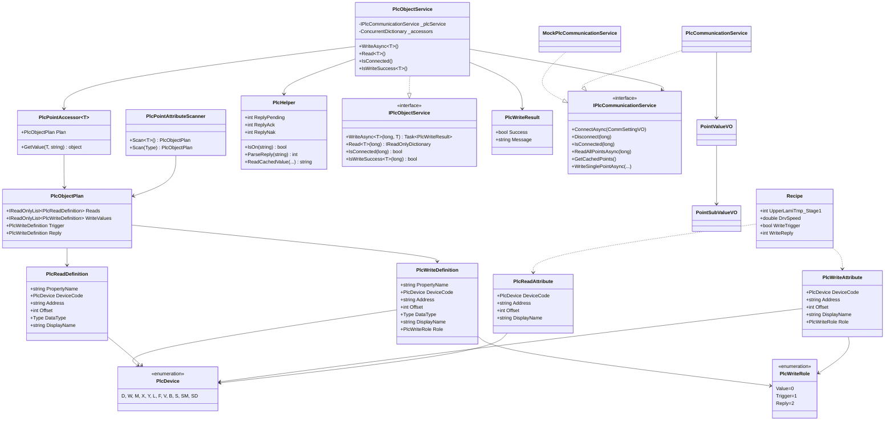
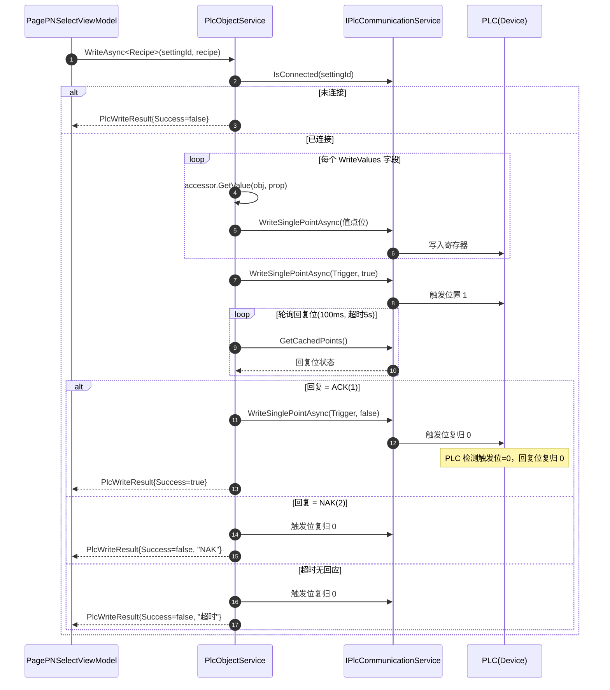
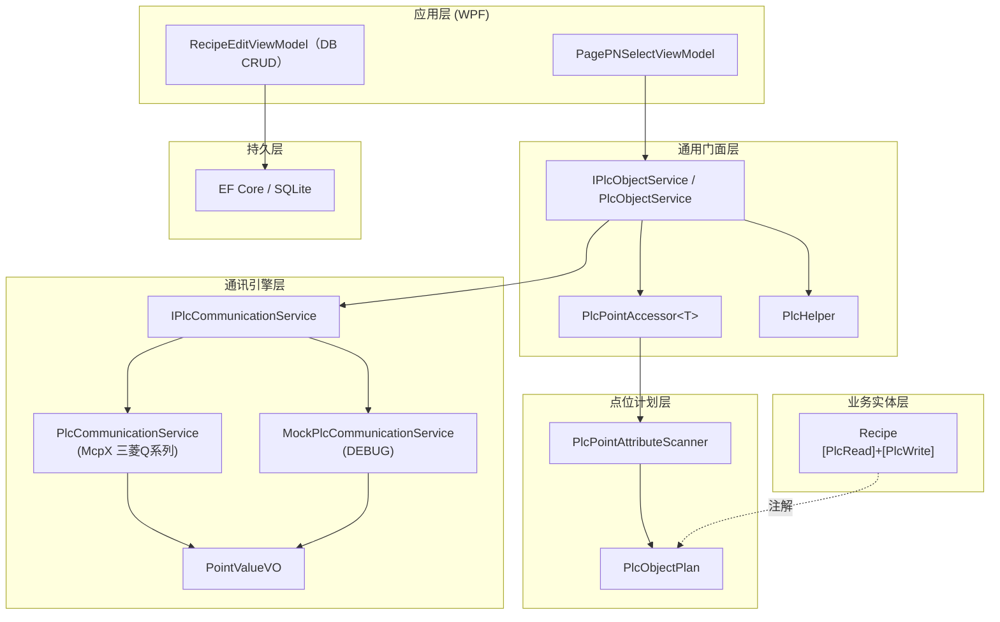

# PLC 通讯框架详细设计文档

> 版本：v1.0（读写注解分离 + 通用对象门面）
> 项目：mcpx_template_project
> 技术栈：C# / WPF / .NET 8 / CommunityToolkit.Mvvm / EF Core / McpX（三菱 MC 协议）

---

## 1. 设计目标与核心理念

本框架把「PLC 点位读写」从通讯细节中彻底抽象出来，让业务开发者**像写 MyBatis-Plus 一样**操作 PLC：

```csharp
// 1. 给对象属性赋值（实体已打注解）
recipe.UpperLamiTmp_Stage1 = 120;
recipe.DrvSpeed = 3.5;

// 2. 直接调 write 方法，底层自动完成：扫描注解 → 分类点位 → 握手 → 下发
var result = await _plcObjectService.WriteAsync<Recipe>(settingId, recipe);

// 3. 读回也只需一个调用，拿回「属性名 → 当前值」字典
var current = _plcObjectService.Read<Recipe>(settingId);
```

**开发者无需再写** `Scan`、`FirstOrDefault`、`Where`、地址拼接、握手轮询等样板代码——这些全部下沉到底层门面 `PlcObjectService`。

### 核心理念

| 维度 | 当前方案 |
| --- | --- |
| 注解模型 | **读/写分离**：`[PlcRead]` + `[PlcWrite]` |
| 设备代号 | **枚举** `PlcDevice.D` / `PlcDevice.M` |
| 点位分类 | 扫描器自动分类为 `PlcObjectPlan` |
| 读写入口 | **通用门面** `IPlcObjectService` |
| 底层返回 | **原始字典** `属性名 → 当前值` |
| 写握手 | **三态握手**（0=处理中 / 1=ACK / 2=NAK） |

---

## 2. 分层架构

```
┌────────────────────────────────────────────────────────────────┐
│  业务实体层（Recipe 等，打 [PlcRead] / [PlcWrite] 注解）           │
│  开发者唯一要写的：定义属性 + 打注解                                │
└──────────────────────────┬─────────────────────────────────────┘
                           │ 反射扫描（启动一次，结果缓存）
┌──────────────────────────▼─────────────────────────────────────┐
│  点位计划层：PlcPointAttributeScanner → PlcObjectPlan            │
│  自动分类：Reads / WriteValues / Trigger / Reply                  │
└──────────────────────────┬─────────────────────────────────────┘
                           │
┌──────────────────────────▼─────────────────────────────────────┐
│  通用门面层：IPlcObjectService / PlcObjectService                │
│  WriteAsync（含三态握手）/ Read（返回字典）/ IsConnected           │
│  辅助：PlcHelper（IsOn / ParseReply / ReadCachedValue）           │
│  取值：PlcPointAccessor<T>（表达式树编译 getter，零反射）           │
└──────────────────────────┬─────────────────────────────────────┘
                           │ 调用 WriteSinglePointAsync / GetCachedPoints
┌──────────────────────────▼─────────────────────────────────────┐
│  通讯引擎层：IPlcCommunicationService                            │
│  ├─ PlcCommunicationService（真实，McpX 三菱Q系列 MC协议）          │
│  └─ MockPlcCommunicationService（调试，模拟点位+配方握手）          │
│  数据模型：PointValueVO / PointSubValueVO                         │
└────────────────────────────────────────────────────────────────┘
```

---

## 3. 核心类型详解

### 3.1 注解（`Aspect/Attributes/`）

#### `PlcDevice`（枚举，替代魔法字符串）

| 枚举成员 | 值 | 软元件 | 类型 |
| --- | --- | --- | --- |
| `D` | 0 | 数据寄存器 | 字 |
| `W` | 1 | 链接寄存器 | 字 |
| `M` | 2 | 内部继电器 | 位 |
| `X` | 3 | 输入继电器 | 位 |
| `Y` | 4 | 输出继电器 | 位 |
| `L` | 5 | 锁存继电器 | 位 |
| `F` | 6 | 报警器 | 位 |
| `V` | 7 | 边沿继电器 | 位 |
| `B` | 8 | 链接继电器 | 位 |
| `S` | 9 | 步进继电器 | 位 |
| `SM` | 10 | 特殊继电器 | 位 |
| `SD` | 11 | 特殊寄存器 | 字 |

#### `PlcReadAttribute` — 读点位注解

```csharp
[AttributeUsage(AttributeTargets.Property, AllowMultiple = false, Inherited = true)]
public sealed class PlcReadAttribute : Attribute
{
    public PlcDevice DeviceCode { get; }   // 设备代号（枚举）
    public string Address { get; }         // 段起始地址
    public int Offset { get; }             // 段内偏移
    public string? DisplayName { get; set; } // 中文显示名
}
```

#### `PlcWriteAttribute` — 写点位注解

```csharp
[AttributeUsage(AttributeTargets.Property, AllowMultiple = false, Inherited = true)]
public sealed class PlcWriteAttribute : Attribute
{
    public PlcDevice DeviceCode { get; }   // 设备代号（枚举）
    public string Address { get; }         // 段起始地址
    public int Offset { get; }             // 段内偏移
    public string? DisplayName { get; set; }
    public PlcWriteRole Role { get; set; } = PlcWriteRole.Value; // 点位角色
}
```

#### `PlcWriteRole`（写点位角色枚举）

| 成员 | 值 | 含义 |
| --- | --- | --- |
| `Value` | 0 | 普通值点位（业务数据下发） |
| `Trigger` | 1 | 写入触发位（置 1 通知 PLC 开始处理） |
| `Reply` | 2 | 回复位（PLC 回写三态：0/1/2） |

> 关键设计：通过 `Role` 在扫描阶段就把写点位自动分类，业务代码无需按属性名二次判断。

### 3.2 点位定义模型（`Domain/Model/Plc/`）

#### `PlcReadDefinition`

| 字段 | 类型 | 说明 |
| --- | --- | --- |
| `PropertyName` | `string` | 业务属性名 |
| `DeviceCode` | `PlcDevice` | 设备代号 |
| `Address` | `string` | 段起始地址 |
| `Offset` | `int` | 段内偏移 |
| `DataType` | `Type` | 业务属性 CLR 类型 |
| `DisplayName` | `string?` | 中文显示名 |

#### `PlcWriteDefinition`

在 `PlcReadDefinition` 基础上多一个 `Role`（`PlcWriteRole`）。

#### `PlcObjectPlan`（扫描结果分类容器）

```csharp
public class PlcObjectPlan
{
    public IReadOnlyList<PlcReadDefinition> Reads { get; set; }        // 读点位
    public IReadOnlyList<PlcWriteDefinition> WriteValues { get; set; } // 写值点位（Role=Value）
    public PlcWriteDefinition? Trigger { get; set; }                    // 触发位（Role=Trigger）
    public PlcWriteDefinition? Reply { get; set; }                      // 回复位（Role=Reply）
}
```

---

## 4. 注解扫描与取值（性能关键）

### 4.1 `PlcPointAttributeScanner`（静态，`ConcurrentDictionary` 缓存）

- 启动后每个类型只反射**一次**，结果缓存到 `ConcurrentDictionary<Type, PlcObjectPlan>`。
- 遍历 `Type.GetProperties(Public | Instance)`（**含继承链属性**）。
- 分别收集 `[PlcRead]` 和 `[PlcWrite]`，用 `HashSet` 按属性名去重（子类 override 保留最派生声明）。
- 最后按 `Role` 一次分类为 `Reads / WriteValues / Trigger / Reply`。

### 4.2 `PlcPointAccessor<T>`（表达式树编译 getter）

- 构造时编译每个属性的 get 委托（`Expression.Property` + `Convert` + `Compile`）。
- 运行期 `GetValue(obj, propertyName)` **零反射**取值，供门面逐字段下发。

```csharp
public sealed class PlcPointAccessor<T> where T : class
{
    public PlcObjectPlan Plan { get; }   // 扫描缓存
    public object? GetValue(T obj, string propertyName) { ... }
}
```

---

## 5. 通用门面 `IPlcObjectService`

```csharp
public interface IPlcObjectService
{
    Task<PlcWriteResult> WriteAsync<T>(long settingId, T obj) where T : class;
    IReadOnlyDictionary<string, string> Read<T>(long settingId) where T : class;
    bool IsConnected(long settingId);
    bool IsWriteSuccess<T>(long settingId) where T : class;
}
```

### 5.1 `WriteAsync<T>` 写入流程（含三态握手）

```
① 检查连接（IsConnected）→ 未连接直接返回失败
② 逐字段下发 WriteValues（Role=Value），表达式树取值
③ 若存在 Trigger：触发位置 1，通知 PLC 开始处理
④ 若存在 Reply：轮询回复位（100ms 间隔，超时 5s）
     - 0 = 处理中（继续等待）
     - 1 = ACK（成功）
     - 2 = NAK（失败）
⑤ 收到回复后：触发位复归 0
⑥ PLC 检测到触发位回 0 → 回复位复归 0（由 PLC 侧执行）
⑦ 返回 PlcWriteResult（Success + Message）
⑧ 异常时尽力复位触发位，避免 PLC 停留在接收状态
```

### 5.2 `Read<T>` 读回

- 从 `GetCachedPoints()` 中按 `settingId` 过滤。
- 对每个 `Reads` 定义，用 `PlcHelper.ReadCachedValue` 定位 `(设备代号, 地址)` 取当前值。
- 返回 `属性名 → 当前值文本` 的**原始字典**（底层保持纯粹，展示层自行加工）。

### 5.3 `PlcWriteResult`

```csharp
public class PlcWriteResult
{
    public bool Success { get; set; }
    public string Message { get; set; } = string.Empty;
}
```

---

## 6. `PlcHelper`（无状态纯工具）

| 成员 | 说明 |
| --- | --- |
| `ReplyPending = 0` | 回复位：无回应（处理中） |
| `ReplyAck = 1` | 回复位：ACK（成功） |
| `ReplyNak = 2` | 回复位：NAK（失败） |
| `IsOn(text)` | 判断文本是否为 ON/1/true |
| `ParseReply(text)` | 解析回复位文本为三态 0/1/2 |
| `ReadCachedValue(cached, device, address)` | 从缓存列表定位 `(设备,地址)` 的当前值 |

---

## 7. 通讯引擎层 `IPlcCommunicationService`

```csharp
public interface IPlcCommunicationService
{
    Task<bool> ConnectAsync(CommSettingVO setting);
    string? LastError { get; }
    void Disconnect(long settingId);
    bool IsConnected(long settingId);
    Task<List<PointValueVO>> ReadAllPointsAsync(long settingId);
    List<PointValueVO> GetCachedPoints();
    List<long> GetConnectedSettingIds();
    Task<bool> WriteSinglePointAsync(long settingId, string deviceCode, string plcAddress, object value);
}
```

### 7.1 `PlcCommunicationService`（真实实现，McpX）

- 三菱 Q 系列，MC 协议 / 3E·4E 帧 / TCP / 二进制。
- 连接时依次尝试 4 种「帧类型 × 通信格式」组合（3E二进制 → 4E二进制 → 3E ASCII → 4E ASCII）。
- 位设备用 `Prefix` 集合区分，写 `bool`，字设备按值类型分派到 `WriteUInt16 / WriteInt32 / WriteDouble` 等。
- 读以 `ushort`（字）/ `bool`（位）为单位，地址按十六进制递增展开子值。
- 内置 PLC 错误码翻译表（C200~C060），连接失败返回可读的排查建议。

### 7.2 `MockPlcCommunicationService`（调试实现）

- `#if DEBUG` 下注入，不建真实连接。
- 随机生成位/字模拟值；配方专用点位（`AreaType=RECIPE`）不随机化。
- 内置配方写点/读点/触发位/回复位注入与三态握手模拟：
  1. 写值回写到读点；
  2. 回复位 → ACK(1)；
  3. 后台轮询触发位，PC 置 0 后回复位复归 0。

### 7.3 数据模型 `PointValueVO`

- 一个 `PointValueVO` 对应一条区域配置（`CommSettingArea`）。
- 读取多值时展开为 `Values`（`PointSubValueVO` 子值列表），每子值对应一个 PLC 地址。
- 位设备值为 `ON/OFF`，字设备为数值文本。

---

## 8. 配方业务实体（示例）

`Recipe` 实体 16 个工艺字段全部打 `[PlcRead] + [PlcWrite]`，另含两个握手位（`[NotMapped]` 排除 EF 映射但保留注解）：

| 属性 | 读点 | 写点 | 说明 |
| --- | --- | --- | --- |
| `UpperLamiTmp_Stage1` | D2034 | D3700 | 一段上热压轮温度 |
| `LowerLamiTmp_Stage1` | D2035 | D3701 | 一段下热压轮温度 |
| `UpperLamiTmp_Stage2` | D2036 | D3713 | 二段上热压轮温度 |
| `LowerLamiTmp_Stage2` | D2037 | D3714 | 二段下热压轮温度 |
| `MembraneWidth` | D220 | D3712 | 膜宽（枚举） |
| `PanelOutTmp` | D2032 | D3721 | 出板温度 |
| `UpperTackingTmp` | D2030 | D3707 | 上贴膜温度 |
| `LowerTackingTmp` | D2031 | D3708 | 下贴膜温度 |
| `DrvSpeed` | D600 | D3702 | 输送速度 |
| `UpperTackingPressure` | D760 | D3720 | 上贴膜压力 |
| `FrontCuPos` | D603 | D3703 | 前留铜 |
| `RearCuPos` | D605 | D3704 | 后留铜 |
| `RollerPressure_Stage1` | D730 | D3709 | 一段压轮压力 |
| `RollerPressure_Stage2` | D770 | D3719 | 二段压轮压力 |
| `DurationFilm` | D221 | D3710 | 贴膜时间 |
| `PlateThickness` | D219 | D3711 | 板厚 |
| `WriteTrigger`（NotMapped） | — | M2804 (Trigger) | 写入触发位 |
| `WriteReply`（NotMapped） | — | M2101 (Reply) | 回复位 |

---

## 9. 依赖注入

`BusinessServiceRegister.AddBusinessModuleServices`：

```csharp
services.AddSingleton<ICommSettingService, CommSettingServiceImpl>();
services.AddSingleton<IFileService, FileServiceImpl>();

#if DEBUG
services.AddSingleton<IPlcCommunicationService, MockPlcCommunicationService>();
#else
services.AddSingleton<IPlcCommunicationService, PlcCommunicationService>();
#endif

services.AddSingleton<IPlcObjectService, PlcObjectService>();   // 通用门面
services.AddSingleton<IRecipeService, RecipeServiceImpl>();     // 配方 CRUD
```

---

## 10. 展示层消费（PagePNSelectViewModel）

- **CRUD（新增/编辑/删除）只操作数据库**，通过 `RecipeEditViewModel` 弹窗，不碰 PLC。
- **仅「写入配方」触发 PLC**：`_plcObjectService.WriteAsync<Recipe>(settingId, recipe)`。
- **右侧实时读回**：`DispatcherTimer` 每秒 `_plcObjectService.Read<Recipe>(...)` 取字典，回填 `RecipeFieldReadback`。
- 写入结果三态驱动 UI：`null=未写入` / `true=成功(绿)` / `false=失败(红)`。

---

## 11. UML 图

### 11.1 类图



### 11.2 写入时序图



### 11.3 分层部署图



---

## 12. 关键设计原则小结

1. **注解驱动，零样板**：开发者只需在实体上打注解，读写全部走通用门面。
2. **读写分离**：`[PlcRead]` 与 `[PlcWrite]` 各司其职，语义清晰，避免一个注解混杂两种语义。
3. **类型安全**：设备代号用 `PlcDevice` 枚举，杜绝 `"D"/"M"` 魔法字符串拼错。
4. **角色自动分类**：`PlcWriteRole`（Value/Trigger/Reply）让扫描器一次分类，业务零判断。
5. **底层纯粹**：门面 `Read` 只返回 `属性名 → 当前值` 字典，展示逻辑留在 VM。
6. **性能**：反射扫描结果缓存 + 表达式树编译 getter，运行期零反射。
7. **可测试**：`IPlcCommunicationService` 抽象出真实/Mock 双实现，`#if DEBUG` 自动切换。
8. **健壮**：三态握手 + 异常时复位触发位，避免 PLC 卡在接收状态。
