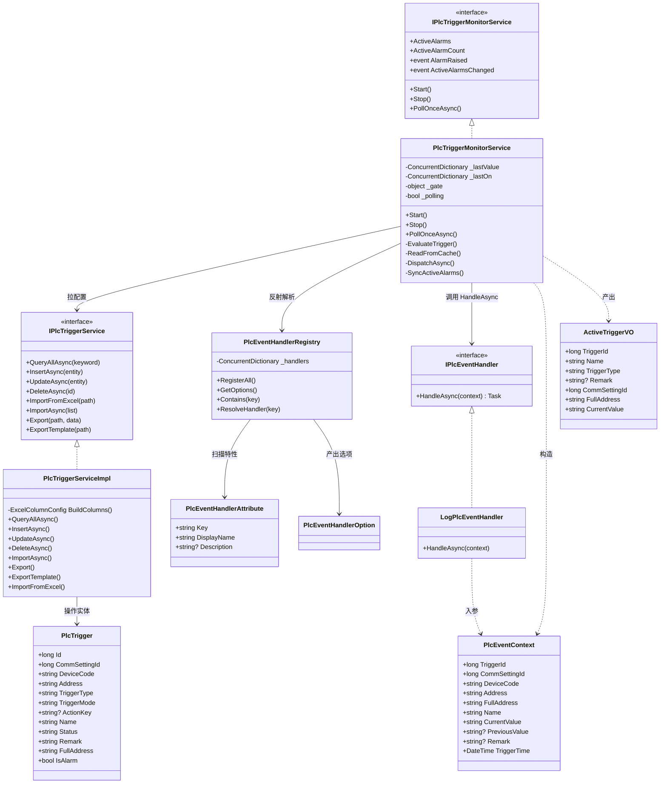
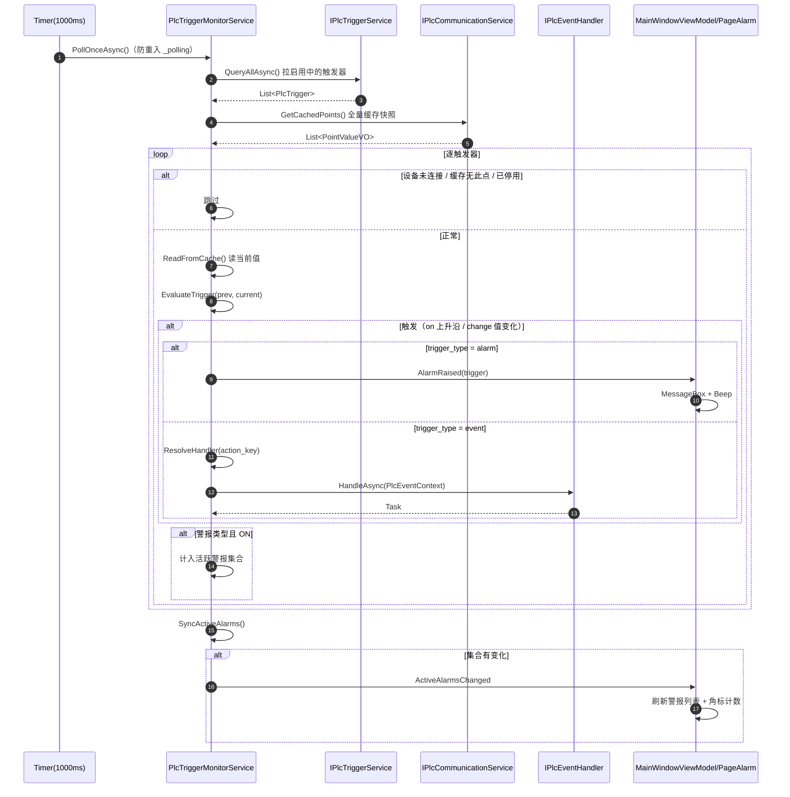
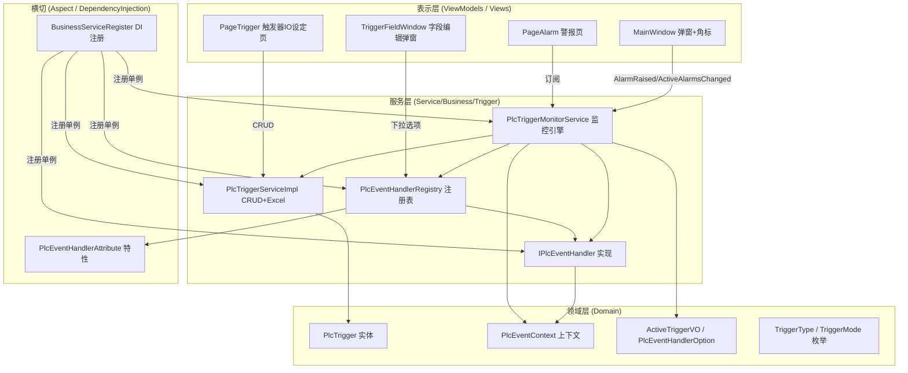
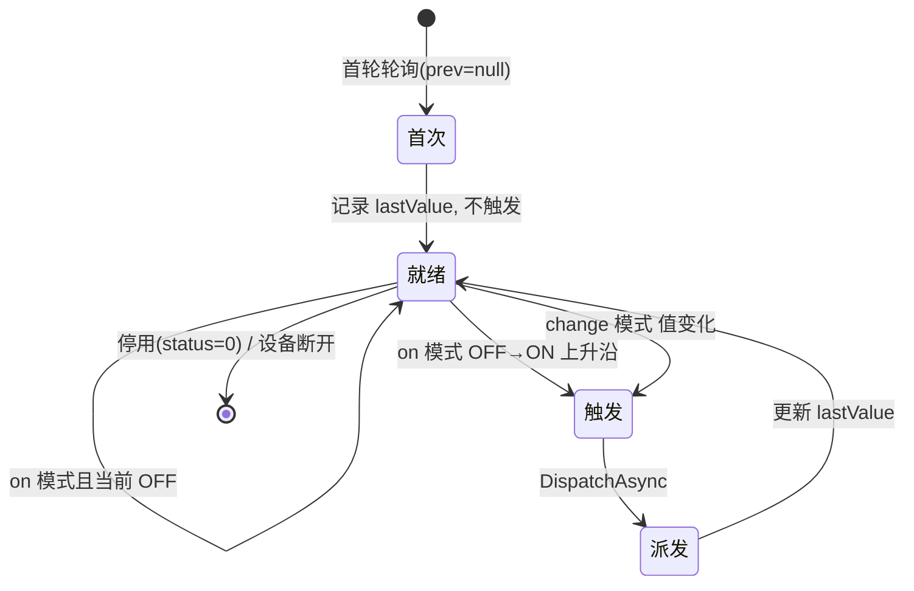

# PLC 警报与事件（统一触发器）架构文档

> 适用项目：mcpx_template_project（C# / WPF / .NET 8 / SQLite / EF Core / McpX 三菱 MC 协议）
> 本文档描述「警报（Alarm）」与「事件（Event）」统一触发器模型的完整架构、数据流与扩展方式。

---

## 1. 设计目标与核心思想

传统方案中「警报」和「事件」往往用两套独立机制维护，导致配置分散、代码重复。本架构将其**统一为一张触发器配置表 `plc_trigger`**，用 `trigger_type` 字段区分用途：

| trigger_type | 含义 | 触发后的动作 |
| --- | --- | --- |
| `alarm` | 警报 | 触发 `AlarmRaised` 事件，UI 弹窗提示 + 侧边栏角标计数 |
| `event` | 事件 | 反射调用 `action_key` 对应的事件处理器（业务方法） |

**核心思想**：点位值变化只是「触发」，触发后「做什么」由类型决定——警报走通知链路，事件走业务处理器链路，两者共享同一套「读缓存 → 判定 → 派发」的监控引擎。

---

## 2. 关键设计决策

1. **警报与事件统一一张 `plc_trigger` 表**，`trigger_type` 区分，避免两套表、两套服务。
2. **事件处理器采用「接口 + DI + 注解」**：
   - 处理器实现 `IPlcEventHandler` 接口；
   - 用 `[PlcEventHandler("Key", "显示名")]` 特性声明唯一 Key 与展示名；
   - 启动时 `PlcEventHandlerRegistry` 扫描装配自动登记，配点界面下拉框读取；
   - 触发时按 `action_key` 反射（经 DI 构造函数解析）调用。
3. **触发方式支持两种**：`on`（上升沿 OFF→ON）与 `change`（值变化）。
4. **单线程串行轮询**，天然避免同一点重复弹窗；不同点同时 ON 各弹各窗，无并发竞争。
5. **点位值从缓存读，不直读 PLC**：由通讯引擎的批量读取周期负责刷新缓存，监控服务只读快照，零额外 PLC 请求。

---

## 3. 数据库表结构

表名：`plc_trigger`

| 列名 | 类型 | 说明 |
| --- | --- | --- |
| `id` | INTEGER | 主键（自增） |
| `comm_setting_id` | INTEGER | 所属通讯设定 ID（`comm_setting.id`，哪个设备） |
| `device_code` | TEXT(8) | 设备代号（D/W/M/X/Y/L/F/B） |
| `address` | TEXT(32) | 点位地址（如 100、2034） |
| `trigger_type` | TEXT(8) | 触发器类型：`alarm` / `event` |
| `trigger_mode` | TEXT(8) | 触发方式：`on`（上升沿）/ `change`（值变化） |
| `action_key` | TEXT(64) | 事件处理器 Key（仅 `event` 类型有效） |
| `name` | TEXT(100) | 触发名 / 警报名 |
| `status` | TEXT(1) | 是否启用监控：`0`=停用，`1`=启用 |
| `remark` | TEXT | 备注（继承自 BaseEntity） |

> 完整点位 = `device_code` + `address`，如 `M100`、`D2034`（实体 `FullAddress` 属性）。

---

## 4. 目录与文件结构

> 按「领域模型 / 服务接口与实现 / AOP 特性 / DI 注册 / 视图层」分层组织，特性与注册表已从 Service 目录抽离归类。

```
Domain/
  Enums/
    TriggerType.cs            # 枚举：alarm / event
    TriggerMode.cs            # 枚举：on / change
  Entities/Business/Trigger/
    PlcTrigger.cs             # 触发器实体（表 plc_trigger）
  Model/Plc/
    PlcEventContext.cs        # 事件触发上下文（传参给处理器）
    PlcObjectPlan.cs          # PLC 对象读写计划（握手协议）
    PlcReadDefinition.cs      # 读点定义
    PlcWriteDefinition.cs     # 写点定义
  VO/Trigger/
    ActiveTriggerVO.cs        # 活跃警报视图对象
    PlcEventHandlerOption.cs  # 事件处理器下拉选项

Aspect/
  Attributes/
    PlcEventHandlerAttribute.cs  # [PlcEventHandler] 特性（与 Log/PlcRead/PlcWrite 特性归类）
    LogAttribute.cs
    PlcReadAttribute.cs
    PlcWriteAttribute.cs

Service/Business/Trigger/
  IPlcEventHandler.cs         # 事件处理器接口（HandleAsync）
  IPlcTriggerService.cs       # 触发器 CRUD + Excel 导入导出
  impl/PlcTriggerServiceImpl.cs
  IPlcTriggerMonitorService.cs # 监控服务接口
  impl/PlcTriggerMonitorService.cs
  impl/LogPlcEventHandler.cs   # 示例事件处理器

DependencyInjection/
  PlcEventHandlerRegistry.cs   # 处理器注册表（扫描 + 反射解析）
  BusinessServiceRegister.cs   # 业务服务注册（含触发器服务/监控/注册表/处理器）
  BusinessViewRegister.cs      # 视图与 VM 注册

ViewModels/Business/Trigger/
  PageAlarmViewModel.cs        # 警报页 VM（展示正在发生的警报）
  PageTriggerViewModel.cs      # 触发器 IO 设定页 VM（CRUD）+ TriggerFieldViewModel

Views/Pages/Business/Trigger/
  PageAlarm.xaml(.cs)          # 警报页（纯展示）
  PageTrigger.xaml(.cs)        # 触发器 IO 设定页（CRUD，仅 admin）
  TriggerFieldWindow.xaml(.cs) # 单条触发器字段编辑弹窗
```

> 注意：`PlcEventHandlerAttribute`、`PlcEventContext`、`PlcEventHandlerRegistry` 三个类虽然物理文件分别移动到了 `Aspect/Attributes/`、`Domain/Model/Plc/`、`DependencyInjection/`，但**命名空间均保持 `mcpx_template_project.Service.Business.Trigger`**，因此引用关系与编译不受影响。

---

## 5. 数据流

### 5.1 监控引擎（后台轮询）

`PlcTriggerMonitorService` 是唯一监控引擎，单线程串行：

```
启动 Start() ──► System.Threading.Timer（周期 1000ms，防重入 _polling 门闩）
        │
        ▼
PollOnceAsync()
  1. QueryAllAsync() 拉取「启用中」的触发器配置
  2. GetCachedPoints() 取一次全量缓存快照（不逐点请求 PLC）
  3. 逐触发器：
       - 设备未连接 → 跳过
       - 从缓存读当前值（找不到 → 跳过）
       - EvaluateTrigger(prev, current) 判定是否触发
       - 记录上次值 / ON 状态
       - 触发 → DispatchAsync()
       - alarm 类型且 ON → 计入活跃警报集合
  4. SyncActiveAlarms() 同步活跃警报集合（有变化触发 ActiveAlarmsChanged）
```

### 5.2 触发判定

```csharp
// on 模式：OFF→ON 上升沿（首次不触发，避免启动瞬间所有 ON 点集体弹窗）
IsOn(current) && !IsOn(previous)

// change 模式：值变化
!string.Equals(previous, current, OrdinalIgnoreCase)
```

首次轮询 `previous == null` 时**一律不触发**，防止程序启动时批量误报。

### 5.3 动作派发

```
DispatchAsync(trigger, prev, current)
  ├─ IsAlarm ──► AlarmRaised?.Invoke(trigger)   // UI 订阅弹窗 + 角标
  └─ event    ──► 按 action_key 反射 ResolveHandler → handler.HandleAsync(context)
```

---

## 6. 事件处理器扩展方式

新增一个业务事件只需三步，无需改动监控引擎与配置界面：

```csharp
using mcpx_template_project.Service.Business.Trigger;

namespace mcpx_template_project.Service.Business.Trigger.impl
{
    /// <summary>示例：某点位 ON 时触发报警灯。</summary>
    [PlcEventHandler("alarm_lamp_on", "触发报警灯", Description = "点位 ON 时点亮报警灯")]
    public class AlarmLampEventHandler : IPlcEventHandler
    {
        public Task HandleAsync(PlcEventContext context)
        {
            // 业务逻辑：context.FullAddress / CurrentValue / TriggerTime ...
            return Task.CompletedTask;
        }
    }
}
```

要点：
- 类必须实现 `IPlcEventHandler` 并**在 DI 容器中注册**（或能被 `ActivatorUtilities` 实例化）。
- `[PlcEventHandler]` 的 `Key` 全局唯一，存到 `plc_trigger.action_key`。
- 配点界面的事件处理器下拉框自动读取注册表中的所有处理器，无需手输 Key。

---

## 7. 配置界面（触发器 IO 设定）

- 入口：侧边栏「触发器 IO 设定」菜单（仅 admin 可见）。
- 功能：触发器的增删改查、Excel 导入/导出、导出模板。
- 字段编辑弹窗 `TriggerFieldWindow`：选择设备、设备代号、点位、触发器类型（警报/事件）、触发方式（上升沿/值变化）、事件处理器（仅事件类型显示）、触发名、启用状态、备注。
- Excel 列：ID、CommSettingID、类型、点位、触发器类型、触发方式、事件处理器 Key、触发名、状态、Remark。

---

## 8. 警报展示与通知

- **警报页（PageAlarm）**：实时展示「当前正在发生的警报」（点位 ON 的 alarm 类型触发器），含警报 ID、警报名、点位、当前值、备注。
- **主界面弹窗**：`MainWindowViewModel` 订阅 `AlarmRaised`，触发时 `MessageBox.Show` + `SystemSounds.Beep` 提示。
- **侧边栏角标**：订阅 `ActiveAlarmsChanged`，`ActiveAlarmCount` 驱动菜单 `InfoBadge`，警报数为 0 时隐藏。

---

## 9. 并发与一致性说明

- **单线程串行轮询**：`System.Threading.Timer` + `_polling` 门闩保证同一时刻只有一轮轮询，不存在并发写共享状态。
- **共享状态保护**：`ActiveAlarms`、`ActiveAlarmCount`、`_lastValue`、`_lastOn` 均通过 `lock(_gate)` 或 `ConcurrentDictionary` 保护。
- **同一点重复弹窗**：由 `on` 模式上升沿判定天然规避（OFF→ON 只触发一次，回落再 ON 才再次触发）。
- **多点同时 ON**：串行遍历各自独立判定、各自触发，互不阻塞。

---

## 10. 历史遗留与注意事项

1. 旧 `alarm` 表（初版警报功能）已被 `plc_trigger` 取代，旧表数据**不会自动迁移**，需重录或写迁移 SQL。
2. `IPlcCommunicationService.ReadSinglePointAsync(long,string,string)` 已无调用方，属死代码，可清理。
3. 菜单通过 `DatabaseInitializer.EnsureTriggerMenu` 自动创建「警报」「触发器 IO 设定」两个子菜单；旧库已存在指向旧组件的菜单需在菜单管理中删除或改 Component。
4. 事件处理器为单例或瞬态取决于 DI 注册方式，建议无状态实现，避免并发下共享可变状态。

---

## 11. UML 图

> 以下均使用 Mermaid 语法，在支持 Mermaid 的 Markdown 预览器（GitHub / VS Code + Mermaid 插件 / Typora）中可直接渲染为图。

### 11.1 核心类图



### 11.2 监控轮询时序图



### 11.3 包 / 组件分层图



### 11.4 触发判定状态图（单触发器）



### 11.5 审查要点清单

对照上述 UML，建议重点审查以下环节：

| 审查项 | 关注点 | 对应图 |
| --- | --- | --- |
| 单线程串行保证 | `_polling` 门闩 + `lock(_gate)` 是否覆盖所有共享状态读写 | 11.2 |
| 缓存读取边界 | `GetCachedPoints()` 返回快照是否与通讯引擎刷新周期解耦 | 11.2 |
| 反射安全性 | `ResolveHandler` 的 `GetService`/`ActivatorUtilities` 回退路径是否健壮 | 11.1 |
| 首次不触发 | `previous == null` 直接返回 false，避免启动批量误报 | 11.4 |
| 处理器无状态 | 单例处理器是否持有可变状态（并发风险） | 11.1 / 11.3 |
| 事件 Key 一致性 | `action_key` 与 `[PlcEventHandler].Key` 是否大小写一致（注册表忽略大小写） | 11.1 |
| 菜单/组件指向 | 警报→PageAlarm、触发器→PageTrigger 与数据库 sys_menu 是否一致 | 11.3 |
