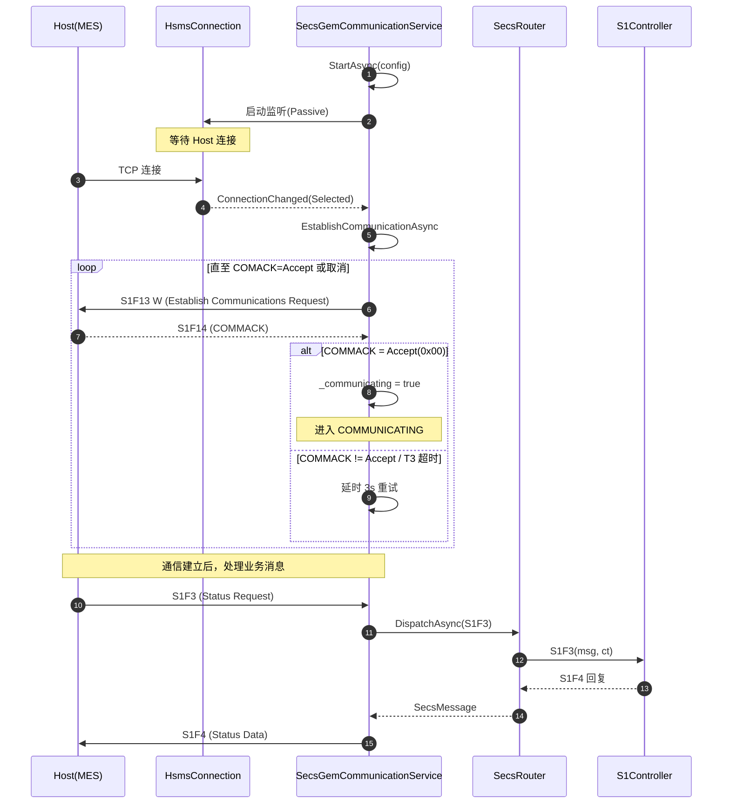
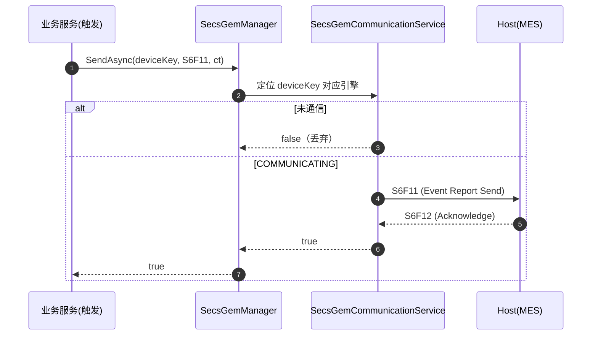
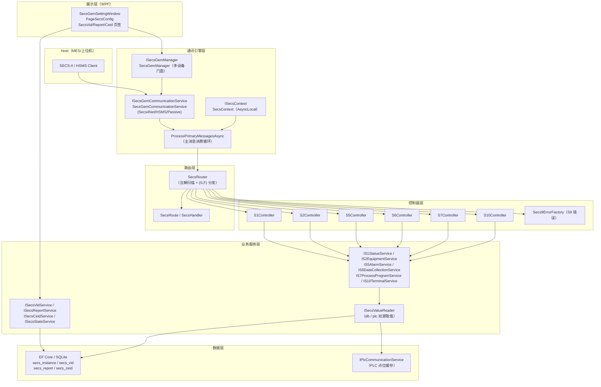

# SECS/GEM 通讯框架详细设计文档

> 版本：v1.0
> 项目：mcpx_template_project
> 技术栈：C# / WPF / .NET 8 / CommunityToolkit.Mvvm / EF Core / Secs4Net
> 角色：**Equipment 端（Passive，被动监听，等待 Host 主动连接）**

---

## 1. 设计目标与核心理念

本框架把 SECS/GEM 协议处理与业务逻辑彻底解耦，让业务开发者**像写 SpringMVC 一样**处理 SECS 消息：

```csharp
// 1. 定义一个 Controller 处理 Stream 1（设备状态）
[SecsStream(1)]
public class S1Controller : ISecsController
{
    // 2. 用 [SecsFunction] 标注处理 S1F1（Are You There）
    [SecsFunction(1)]
    public Task<SecsMessage?> S1F1(SecsMessage primaryMsg, CancellationToken ct)
    {
        return Task.FromResult(new SecsMessage(1, 2, replyExpected: false)
        {
            SecsItem = Item.L(Item.A(_statusService.ModelName), Item.A(_statusService.SoftwareRevision))
        });
    }
}
```

**开发者无需再写** 消息分发 switch-case、报文字节编解码、回复状态机等样板代码——这些全部下沉到 `SecsRouter`（路由）与 `SecsGemCommunicationService`（引擎）。

### 核心理念

| 维度 | 当前方案 |
| --- | --- |
| 消息路由 | **注解驱动** `[SecsStream]` + `[SecsFunction]`，类 SpringMVC |
| 协议栈 | **Secs4Net** 库（HSMS，`HsmsConnection` + `SecsGem`） |
| 角色定位 | **Equipment / Passive** 端，监听等待 Host 连接 |
| 多实例 | **多设备管理器** `ISecsGemManager`，按 deviceKey 隔离引擎 |
| 数据模型 | **数据表驱动**（`secs_vid` 替代注解），VID 统一承载 SVID/DVID/ECID |
| 取值来源 | **双源**：`db` 固定值 / `plc` 点位缓存，经 `ISecsValueReader` 统一转换 |
| 控制状态 | **GEM Control State Model**（E30），内存态，按实例隔离 |

---

## 2. 分层架构

```
┌────────────────────────────────────────────────────────────────────┐
│  业务服务层（Service/Business/Secs/）                                │
│  IS1StatusService / IS2EquipmentService / IS5AlarmService /         │
│  IS6DataCollectionService / IS7ProcessProgramService / IS10Terminal… │
│  + ISecsVidService / ISecsReportService / ISecsCeidService /        │
│    ISecsStateService / ISecsValueReader                             │
└──────────────────────────┬──────────────────────────────────────────┘
                           │ 组装 SecsItem，返回业务结果
┌──────────────────────────▼──────────────────────────────────────────┐
│  控制器层（Controller/SecsGem/）—— 注解路由，类 SpringMVC             │
│  S1Controller / S2Controller / S5Controller / S6Controller /        │
│  S7Controller / S10Controller + Secs9ErrorFactory（S9 错误）        │
└──────────────────────────┬──────────────────────────────────────────┘
                           │ (S, F) → Handler 委托
┌──────────────────────────▼──────────────────────────────────────────┐
│  路由层（Core/SecsRoute/）                                          │
│  SecsRouter：扫描 [SecsStream]/[SecsFunction] 构建路由表，按 (S,F) 分发 │
└──────────────────────────┬──────────────────────────────────────────┘
                           │ DispatchAsync(SecsMessage)
┌──────────────────────────▼──────────────────────────────────────────┐
│  通讯引擎层（Service/Business/Secs/impl/）                           │
│  ISecsGemCommunicationService（单设备引擎，Secs4Net/HSMS/Passive）     │
│  ISecsGemManager（多设备门面，按 deviceKey 管理引擎）                 │
│  ISecsContext（AsyncLocal 多实例上下文）                             │
└──────────────────────────┬──────────────────────────────────────────┘
                           │ Secs4Net HSMS
┌──────────────────────────▼──────────────────────────────────────────┐
│  Host（MES / 上位机）                                                │
└─────────────────────────────────────────────────────────────────────┘
```

---

## 3. 核心类型详解

### 3.1 注解（`Aspect/Attributes/SecsAttributes.cs`）

#### `SecsStreamAttribute` — 类级，标记 Stream（1~127）

```csharp
[AttributeUsage(AttributeTargets.Class, AllowMultiple = false, Inherited = false)]
public sealed class SecsStreamAttribute : Attribute
{
    public byte Stream { get; }
    public SecsStreamAttribute(byte stream) => Stream = stream;
}
```

#### `SecsFunctionAttribute` — 方法级，标记 Function（0~255）

```csharp
[AttributeUsage(AttributeTargets.Method, AllowMultiple = false, Inherited = false)]
public sealed class SecsFunctionAttribute : Attribute
{
    public byte Function { get; }
    public SecsFunctionAttribute(byte function) => Function = function;
}
```

#### `SecsPermissionAttribute` — 方法级，SxFy 权限前置增强开关（独立于 SecsFunction）

```csharp
[AttributeUsage(AttributeTargets.Method, AllowMultiple = false, Inherited = false)]
public sealed class SecsPermissionAttribute : Attribute
{
    // 无属性：纯标记。仅作为「该 SxF 需要权限前置校验」的开关。
}
```

**用法**：打在带 `[SecsFunction]` 的方法上，作为前置增强的开关。路由分发前 `SecsRouter` 检测到本注解才查 `secs_sxfy` 表校验；拒绝时回 `SxF0`（Stream 同请求、Function 固定 0）且**消息体为空**的应答。

```csharp
[SecsStream(2)]
public class S2Controller : ISecsController
{
    // 打了注解 → 该 SxF 启用权限校验；权限矩阵由 secs_sxfy 表决定
    [SecsFunction(41)]
    [SecsPermission]
    public async Task<SecsMessage?> S2F41(SecsMessage primaryMsg, CancellationToken ct) { ... }
}
```

**职责划分**（注解是开关，表是白名单）：
1. **未打注解** → 路由分发**直接放行**，不查表（权限表对未标注的方法不生效）；
2. **打了注解 + 表中存在启用条目**（`status="0"`）→ 按该条目状态位判定；
3. **打了注解 + 表中无条目（或停用）** → **默认拦截**（拒绝执行，回空消息体 SxF）。

权限矩阵（OffLine / OnLine Local / OnLine Remote）完全由 `secs_sxfy` 表决定，注解不承载任何默认允许位。

**设计要点**：注解与 `[SecsFunction]` 职责分离 —— `[SecsFunction]` 只负责路由（Stream/Function 映射），`[SecsPermission]` 只负责「是否启用权限校验」开关，权限矩阵下沉到数据表，可运行期配置。

**方法签名约束**：`Task<SecsMessage?> Xxx(SecsMessage primaryMsg, CancellationToken ct)`。
- 返回 `null` → 不回复；
- 返回非 null → 引擎 `TryReplyAsync` 回复给 Host；
- 签名不符的方法在扫描时被跳过并告警。

#### `ISecsController` — 标记接口

所有带 `[SecsStream]` 的 Controller 实现此接口，便于 DI 批量注入与路由扫描。

### 3.2 路由（`Core/SecsRoute/`）

#### `SecsHandler` 委托与 `SecsRoute` 记录

```csharp
public delegate Task<SecsMessage?> SecsHandler(SecsMessage primaryMsg, CancellationToken ct);

public sealed record SecsRoute(byte Stream, byte Function, SecsHandler Handler)
{
    public override string ToString() => $"S{Stream}F{Function}";
}
```

#### `SecsRouter` — 类 DispatcherServlet 的消息路由器

| 成员 | 说明 |
| --- | --- |
| `RegisterControllers(IEnumerable<ISecsController>)` | 扫描所有 Controller，反射读取 `[SecsStream]`/`[SecsFunction]` 构建路由表 |
| `TryGetRoute(stream, function, out route)` | 按 `(S, F)` 查表 |
| `HasStream(stream)` | 判断是否存在该 Stream 的任意路由（区分 S9F3 vs S9F5） |
| `DispatchAsync(primaryMsg, ct)` | 分发到对应 Controller 方法，返回回复（无路由返回 null） |

> 路由重复定义时后者覆盖前者并告警；方法签名不符（返回类型/参数）时跳过。

### 3.3 通讯引擎（`Service/Business/Secs/`）

#### `ISecsGemCommunicationService` — 单设备引擎

| 成员 | 说明 |
| --- | --- |
| `StartAsync(config)` | 启动监听（Passive），内部 `HsmsConnection` + `SecsGem` |
| `Stop()` | 停止监听，异步释放连接（不阻塞调用线程） |
| `SendAsync(msg, ct)` | 设备端主动向 Host 发送（S6F1/S5F1/S9Fx），仅 COMMUNICATING 时有效 |
| `InstanceId` | 多实例场景下用于 `ISecsContext` 注入；单实例为 null |
| `IsRunning` / `IsCommunicating` | 监听中 / 已通信 |
| `StateText` / `DeviceIpAddress` | 连接状态文本 / 对端 IP |
| `StateChanged` / `MessageReceived` | 状态变化 / 收到主消息事件 |

**建立通信（Establish Communications，E30 §4.1.2）**：连接 Selected 后，设备端主动发送 `S1F13 W`，等待 `S1F14`；`COMACK=Accept(0x00)` → 进入 `COMMUNICATING`，否则延时 3s 重试。

#### `ISecsGemManager` — 多设备门面

一个 EQP 端可服务多台设备，每台对应独立引擎（独立 IP/Port/DeviceId/连接/状态）。

| 成员 | 说明 |
| --- | --- |
| `StartAsync(deviceKey, config)` | 启动/重启指定设备监听 |
| `Stop(deviceKey)` / `StopAll()` | 停止单台 / 全部 |
| `SendAsync(deviceKey, msg, ct)` | 指定设备主动上报 |
| `GetEngine(deviceKey)` / `Engines` | 获取引擎 / 全部引擎快照 |
| `IsRunning(deviceKey)` / `IsCommunicating(deviceKey)` | 运行 / 通信状态查询 |

#### `ISecsContext` — 多实例上下文（`AsyncLocal<long?>`）

多引擎并发分发时，引擎在分发消息前 `SetInstance(instanceId)` 把实例 ID 写入 `AsyncLocal`，随 async 调用链流转。Controller 通过 `CurrentInstanceId` 拿到「消息来自哪个实例」，**无需改方法签名**。

### 3.4 配置与状态模型

#### `SecsGemConfiguration`（`Domain/Model/Secs/`，单例，ObservableObject）

| 字段 | 默认 | 说明 |
| --- | --- | --- |
| `IpAddress` | `0.0.0.0` | 本机监听 IP（Passive 绑定） |
| `Port` | `5000` | 监听端口 |
| `DeviceId` | `0` | 设备 ID（Equipment 端通常为 0） |
| `ConnectMode` | `manual` | 启动模式 manual/auto |
| `T3` | `45000` | 回复超时 |
| `T5` | `10000` | 连接建立超时 |
| `T6` | `5000` | 控制消息超时 |
| `T7` | `10000` | 选择状态超时 |
| `T8` | `5000` | 分片接收超时 |

#### `SecsControlState`（`Domain/Enums/`，GEM Control State Model，对齐 E30）

| 枚举 | 值 | 含义 |
| --- | --- | --- |
| `EquipmentOffline` | 1 | 设备离线 |
| `AttemptOnline` | 2 | 尝试在线（过渡态） |
| `HostOffline` | 3 | Host 离线 |
| `OnlineLocal` | 4 | 在线-本地 |
| `OnlineRemote` | 5 | 在线-远程 |

`ISecsStateService` 驱动状态机：`S1F13`→`MarkCommunicating`、`S1F15`→`RequestOffline`、`S1F17`→`RequestOnline`、`S2F41`→`RequestLocal`/`RequestRemote`。内存态、按实例隔离、不落库。

---

## 4. 消息路由分发流程

`SecsGemCommunicationService.ProcessPrimaryMessagesAsync` 是主消息消费循环：

```
① GetPrimaryMessageAsync 收到主消息
② 触发 MessageReceived 事件（日志/UI 展示）
③ 多实例：SetInstance(InstanceId) 注入 AsyncLocal 上下文
④ SecsRouter.DispatchAsync 按 (S, F) 分发到 Controller 方法
    ├─ 有路由：
    │   ├─ 带 [SecsPermission]：先查 secs_sxfy 表校验当前控制状态
    │   │    ├─ 允许（表有启用条目且状态匹配）→ 执行 Controller，异常 → 回 S9F7（IllegalData）
    │   │    └─ 拒绝（无启用条目或状态不匹配）→ 回 SxF0 空消息体，不执行 Controller
    │   └─ 无 [SecsPermission]：直接执行 Controller（不查表），异常 → 回 S9F7
    └─ 无路由：ReplyExpected 时按 HasStream 区分
         ├─ Stream 未知 → S9F3（UnrecognizedStream）
         └─ Function 未知 → S9F5（UnrecognizedFunction）
⑤ S1F13 特殊分支：Host 侧发起建立通信，维护 COMMUNICATING
⑥ 有回复 → TryReplyAsync 回复 Host
```

---

## 5. 消息处理器（Controller）清单

| Controller | Stream | 已实现消息 | 职责 |
| --- | --- | --- | --- |
| `S1Controller` | 1 | S1F1/F3/F11/F13/F15/F17 | 设备状态：在线数据、SVID 查询、建立通信、在线/离线 |
| `S2Controller` | 2 | S2F13/F15/F17/F23/F25/F29/F31/F33/F35/F37/F39/F41/F43/F45/F47/F49 | 设备控制与诊断：ECV 读写、时间、Trace、报表、远程命令、Spooling、限值 |
| `S5Controller` | 5 | S5F3/F5/F7 | 报警：使能/禁用、列举报警 |
| `S6Controller` | 6 | S6F15/F19/F23 | 数据采集：事件报表、独立报表、Spooled 数据 |
| `S7Controller` | 7 | S7F1/F17/F19/F23/F25 | 工艺程序：PPID 装载/删除/上报/收发 |
| `S10Controller` | 10 | S10F3/F5 | 终端服务：终端显示 |
| `Secs9ErrorFactory` | 9 | S9F1/F3/F5/F7/F9/F11/F13 | S9 错误上报（`Secs9ErrorType` 枚举） |

> 说明：S1/S2 已实现 GEM 核心消息；S5/S6/S7/S10 覆盖 E30 基础场景；S3（物料传输）、S8、S14 等暂未实现（Host 发来未注册消息时回 S9F3/S9F5）。

---

## 6. 数据模型（`Domain/Entities/Business/Secs/`，数据表驱动）

### 6.1 核心表关系

| 实体 | 表 | 说明 |
| --- | --- | --- |
| `SecsInstance` | `secs_instance` | SECS 实例（通讯会话），关联 `comm_setting_id`（可空） |
| `SecsVid` | `secs_vid` | VID 统一主表，`vid_type` 区分 SVID/DVID/ECID |
| `SecsReport` | `secs_report` | 报表，`secs_report_vid` 子表维护成员（sort） |
| `SecsCeid` | `secs_ceid` | 收集事件，`secs_ceid_report` 子表维护成员（sort） |
| `SecsSxFy` | `secs_sxfy` | SxFy 消息权限表，定义各控制状态下是否允许执行 |

### 6.2 `SecsSxFy` — SxFy 消息权限表

| 字段 | 类型 | 说明 |
| --- | --- | --- |
| `Stream` | `byte` | 消息 Stream（1~127） |
| `Function` | `byte` | 消息 Function（0~255） |
| `AllowOffline` | `bool` | 设备离线（EquipmentOffline）状态是否允许执行 |
| `AllowOnlineLocal` | `bool` | 在线-本地（OnlineLocal）状态是否允许执行 |
| `AllowOnlineRemote` | `bool` | 在线-远程（OnlineRemote）状态是否允许执行 |
| `Status` | `string` | 启用状态（0=启用，1=停用） |
| `Name` | `string` | 显示名（可选） |

配合方法级 `[SecsPermission]` 注解做 Controller 前置增强：注解是「是否启用校验」的开关，权限矩阵（各状态是否允许）完全由本表决定；打了注解但表中无启用条目时默认拦截。

### 6.3 `SecsVid` — VID 统一主表（替代注解）

| 字段 | 类型 | 说明 |
| --- | --- | --- |
| `VidType` | `SecsVidType` | SVID / DVID / ECID |
| `VidId` | `int` | SECS 消息中的编号（1~65535，同类型内唯一） |
| `Name` | `string` | 变量显示名 |
| `DataType` | `SecsDataType` | SECS 格式码（U1/U2/U4/I2/I4/F4/F8/B/A…） |
| `Source` | `string` | 值来源：`db`（固定值）/ `plc`（PLC 点位） |
| `PlcAddress` / `DeviceCode` | `string?` | PLC 点位地址/设备代号（source=plc 时有效） |
| `DefaultValue` | `string?` | 固定值（source=db 时有效） |
| `Status` | `string` | 启用状态（0=启用，1=停用） |

- **SVID**：状态变量，Host 只读（S1F3/S1F11）
- **DVID**：数据变量，Host 可读写（S2F13/S2F15/S2F29）
- **ECID**：设备常量，Host 只读（S2F13/S2F15/S2F29，与 DVID 共用编号语义）

### 6.4 `SecsValueResult` 与 `ISecsValueReader` — 取值门面

`ISecsValueReader` 负责「db 固定值 / plc 点位缓存」两种来源 → 当前值 `Item` 的转换：

```csharp
public readonly struct SecsValueResult
{
    public int VidId { get; init; }    // VID 编号
    public bool Exists { get; init; }  // 是否存在（未定义/停用=false）
    public Item? Value { get; init; }  // 当前值（SecsItem）
}
```

各 Stream Service（S1/S2/S6）查询 SVID/DVID/ECID 时，用它组装回复报文；VID 停用或类型不支持 → `Exists=false`，按报文约定回空 `Item.L()`。

### 6.5 `SecsAckCodes` — 标准应答码常量

集中定义 COMMACK/OFLACK/ONLACK/EAC/TIACK/DRACK/LRACK/ERACK/TIAACK/ACKC5/ACKC6/ACKC7/ACKC10/PPGNT/HCACK/RSPACK/VLAACK/RSDA 等应答码，Controller 与 Service 共享，避免魔法数字。

### 6.6 HCMD（Host Command）— S2F41 注解驱动自定义命令

Host 通过 S2F41 Remote Command 下发命令（RCMD + 参数列表），设备端通过注解把命令路由到具体方法执行：

```csharp
// 1. 处理器类实现 IHostCommandHandler（注册为单例）
public sealed class HostCommandHandler : IHostCommandHandler
{
    // 2. 打 [Hcmd] 注解：命令名默认取方法名（转大写）
    //    方法参数名即 S2F41 参数列表中的 CPNAME，按名匹配注入
    [Hcmd]   // 命令名 = "PP_SELECT"
    public async Task PP_SELECT(HcmdContext ctx, string EquipID, string PPID, string LotID, string WaferCnt)
    {
        // ctx.InstanceId 获取当前实例；参数已按 CPNAME 注入
    }
}
```

**S2F41 报文示例**（RCMD=`PP_SELECT`，参数 EquipID/PPID/LotID/WaferCnt）：

```
S2F41 W  L,2
  1. <A "PP_SELECT">
  2. L,4
    1. L,2 [ <A "EquipID">, <EQID> ]
    2. L,2 [ <A "PPID">,   <PPID> ]
    3. L,2 [ <A "LotID">,  <LotIDList> ]   (Ex: <A "19B9B283.1,19B9B284.1">)
    4. L,2 [ <A "WaferCnt">, <WaferCntList> ] (Ex: <A "25,23">)
```

**执行流程**：`S2Controller.S2F41` 解析 RCMD + 参数 → `IS2EquipmentService.ExecuteRemoteCommandAsync` → `HcmdRegistry` 查命令名 → 反射调用，按参数名注入；未命中则回退内置命令（REMOTE/LOCAL/ABORT）。

**HCACK 映射**：
| 场景 | HCACK |
| --- | --- |
| 命令执行成功 | `HcackPerformed`（0） |
| 命令未注册 | `HcackCommandNotExist`（1） |
| 缺参 / 参数类型转换失败 | `HcackInvalidParameter`（3） |
| 执行异常 | `HcackCannotPerformNow`（2） |

**参数类型支持**：`string`/`int`/`long`/`double`/`float`/`bool`/`short`/`byte`/`DateTime`/枚举；可选参数（有默认值或可空）缺失时给默认值。

---

## 7. 依赖注入

`BusinessServiceRegister.AddBusinessModuleServices`：

```csharp
// 控制器（路由扫描目标）
services.AddSingleton<ISecsController, S1Controller>();
services.AddSingleton<ISecsController, S2Controller>();
services.AddSingleton<ISecsController, S5Controller>();
services.AddSingleton<ISecsController, S6Controller>();
services.AddSingleton<ISecsController, S7Controller>();
services.AddSingleton<ISecsController, S10Controller>();

// 路由与通讯引擎
services.AddSingleton<SecsRouter>();
services.AddTransient<SecsGemCommunicationService>();
services.AddSingleton<Func<ISecsGemCommunicationService>>(
    sp => () => sp.GetRequiredService<SecsGemCommunicationService>());
services.AddSingleton<ISecsGemManager, SecsGemManager>();
services.AddSingleton<ISecsGemAutoStartService, SecsGemAutoStartService>();
services.AddSingleton<ISecsContext, SecsContext>();

// 业务服务
services.AddSingleton<ISecsInstanceService, SecsInstanceServiceImpl>();
services.AddSingleton<ISecsVidService, SecsVidServiceImpl>();
services.AddSingleton<ISecsReportService, SecsReportServiceImpl>();
services.AddSingleton<ISecsCeidService, SecsCeidServiceImpl>();
services.AddSingleton<ISecsStateService, SecsStateService>();
services.AddSingleton<ISecsValueReader, SecsValueReader>();
services.AddSingleton<IS2TraceService, SecsTraceService>();
// ...（其余 S 流 Service 同理）
```

> 关键：`SecsGemCommunicationService` 注册为 **Transient**，通过 `Func<ISecsGemCommunicationService>` 工厂让 `SecsGemManager` 为每台设备**动态创建独立引擎实例**，支持运行时修改配置后重启监听。

---

## 8. 与 PLC 通讯的关系

SECS 的 VID 取值可来自 PLC 点位（`SecsVid.Source = "plc"`）：

- `SecsInstance.CommSettingId` → 关联 `comm_setting`（PLC 通讯设定）
- `ISecsValueReader` 读取时，`source=plc` 的 VID 从 PLC 通讯引擎的暂存缓存（`IPlcCommunicationService.GetCachedPoints()`）取值，经 `Convert(dataType, textValue)` 转为 Secs4Net `Item`
- `source=db` 的 VID 直接取 `DefaultValue`

这实现了「PLC 采集 → SECS 上报」的完整链路：PLC 引擎周期读取点位 → 暂存缓存 → VID 取值 → Controller 组装 S1F4/S2F14/S6F16 回复 Host。

---

## 9. UML 图

### 9.1 类图

```mermaid
classDiagram
    direction TB

    class ISecsController {
        <<interface>>
    }

    class SecsStreamAttribute {
        +byte Stream
    }
    class SecsFunctionAttribute {
        +byte Function
    }

    class SecsRouter {
        -Dictionary~byte,byte,SecsRoute~ _routes
        +RegisterControllers(controllers)
        +TryGetRoute(stream, function) bool
        +HasStream(stream) bool
        +DispatchAsync(msg, ct) Task~SecsMessage~
    }
    class SecsRoute {
        +byte Stream
        +byte Function
        +SecsHandler Handler
    }

    class S1Controller {
        -IS1StatusService _statusService
        -ISecsStateService _stateService
        -ISecsContext _secsContext
        +S1F1() Task~SecsMessage~
        +S1F3() Task~SecsMessage~
        +S1F13() Task~SecsMessage~
    }
    class S2Controller {
        -IS2EquipmentService _equipmentService
        +S2F13() +S2F15() +S2F33() +S2F41()
    }
    class S5Controller {
        -IS5AlarmService _alarmService
        +S5F3() +S5F5() +S5F7()
    }
    class S6Controller {
        -IS6DataCollectionService _dataService
        +S6F15() +S6F19() +S6F23()
    }
    class S7Controller {
        -IS7ProcessProgramService _programService
        +S7F1() +S7F17() +S7F23() +S7F25()
    }
    class S10Controller {
        -IS10TerminalService _terminalService
        +S10F3() +S10F5()
    }
    class Secs9ErrorFactory {
        <<static>>
        +Create(type, deviceId, stream, function) SecsMessage
        +UnrecognizedStream() SecsMessage
        +UnrecognizedFunction() SecsMessage
        +IllegalData() SecsMessage
    }

    class ISecsGemCommunicationService {
        <<interface>>
        +StartAsync(config) Task~bool~
        +Stop()
        +SendAsync(msg, ct) Task~bool~
        +IsRunning bool
        +IsCommunicating bool
        +StateChanged event
        +MessageReceived event
    }
    class SecsGemCommunicationService {
        -SecsRouter _router
        -ISecsContext _secsContext
        -HsmsConnection _connection
        -SecsGem _gem
        +EstablishCommunicationAsync(ct)
        +ProcessPrimaryMessagesAsync(ct)
    }
    class ISecsGemManager {
        <<interface>>
        +StartAsync(deviceKey, config) Task~bool~
        +Stop(deviceKey)
        +SendAsync(deviceKey, msg, ct) Task~bool~
        +GetEngine(deviceKey)
    }
    class SecsGemManager {
        -Func~ISecsGemCommunicationService~ _factory
        -Dictionary~string, ISecsGemCommunicationService~ _engines
    }

    class ISecsContext {
        <<interface>>
        +CurrentInstanceId long?
        +SetInstance(instanceId) IDisposable
    }
    class SecsContext {
        -AsyncLocal~long~ _currentInstanceId
    }

    class SecsGemConfiguration {
        +string IpAddress
        +int Port
        +ushort DeviceId
        +string ConnectMode
        +int T3 +int T5 +int T6 +int T7 +int T8
    }
    class SecsControlState {
        <<enumeration>>
        EquipmentOffline, AttemptOnline, HostOffline, OnlineLocal, OnlineRemote
    }

    class SecsInstance {
        +long Id
        +string Name
        +string IpAddress
        +int Port
        +ushort DeviceId
        +long CommSettingId
    }
    class SecsVid {
        +long Id
        +SecsVidType VidType
        +int VidId
        +string Name
        +SecsDataType DataType
        +string Source
        +string PlcAddress
        +string DeviceCode
        +string DefaultValue
    }
    class SecsReport {
        +long Id
        +int RptId
        +List~SecsReportVid~ ReportVids
    }
    class SecsCeid {
        +long Id
        +int Ceid
        +List~SecsCeidReport~ CeidReports
    }

    class ISecsStateService {
        <<interface>>
        +GetControlState(instanceId) SecsControlState
        +RequestOnline(instanceId) bool
        +RequestOffline(instanceId) bool
        +RequestLocal(instanceId) bool
        +RequestRemote(instanceId) bool
        +MarkCommunicating(instanceId)
    }
    class ISecsValueReader {
        <<interface>>
        +ReadAsync(instanceId, commSettingId, vid) Task~SecsValueResult~
        +Convert(dataType, textValue) Item
    }
    class IS1StatusService {
        <<interface>>
        +GetStatusValuesAsync(instanceId, svids)
        +GetStatusNamesAsync(instanceId, svids)
    }
    class IS2EquipmentService {
        <<interface>>
        +GetConstantValuesAsync()
        +UpdateConstantsAsync()
        +DefineReportAsync()
        +ExecuteRemoteCommandAsync()
    }
    class IS6DataCollectionService {
        <<interface>>
        +GetEventReportAsync(instanceId, ceid)
        +GetIndividualReportAsync(instanceId, rptid)
    }
    class IS5AlarmService {
        <<interface>>
        +SetAlarmEnabledAsync()
        +ListAlarmsAsync()
    }
    class IS7ProcessProgramService {
        <<interface>>
        +InquireLoadAsync(ppid)
        +StoreProcessProgramAsync()
        +GetProcessProgramAsync(ppid)
    }
    class IS10TerminalService {
        <<interface>>
        +DisplayAsync(instanceId, tid, text)
    }

    S1Controller ..|> ISecsController
    S2Controller ..|> ISecsController
    S5Controller ..|> ISecsController
    S6Controller ..|> ISecsController
    S7Controller ..|> ISecsController
    S10Controller ..|> ISecsController

    S1Controller ..> SecsStreamAttribute
    S1Controller ..> SecsFunctionAttribute
    S2Controller ..> SecsStreamAttribute

    SecsRouter --> SecsRoute
    SecsRouter --> ISecsController

    S1Controller --> IS1StatusService
    S1Controller --> ISecsStateService
    S1Controller --> ISecsContext
    S2Controller --> IS2EquipmentService
    S5Controller --> IS5AlarmService
    S6Controller --> IS6DataCollectionService
    S7Controller --> IS7ProcessProgramService
    S10Controller --> IS10TerminalService

    SecsGemCommunicationService ..|> ISecsGemCommunicationService
    SecsGemCommunicationService --> SecsRouter
    SecsGemCommunicationService --> ISecsContext
    SecsGemCommunicationService --> SecsGemConfiguration
    SecsGemCommunicationService --> Secs9ErrorFactory

    SecsGemManager ..|> ISecsGemManager
    SecsGemManager --> ISecsGemCommunicationService

    SecsContext ..|> ISecsContext

    ISecsStateService --> SecsControlState
    ISecsValueReader --> SecsVid
    IS1StatusService --> SecsVid
    IS6DataCollectionService --> SecsReport
    IS6DataCollectionService --> SecsCeid
    SecsInstance --> SecsVid
    SecsReport --> SecsVid
    SecsCeid --> SecsReport
```



### 9.2 建立通信时序图



### 9.3 主动上报时序图（事件上报示例）



### 9.4 分层部署图



---

## 10. 关键设计原则小结

1. **注解驱动路由**：`[SecsStream]` + `[SecsFunction]` 让新增消息处理只需加一个方法，零 switch-case。
2. **控制器薄、服务厚**：Controller 只做入参解析校验 + 报文组装，业务动作全部下沉到 Service。
3. **多设备隔离**：`ISecsGemManager` + `Func` 工厂 + `ISecsContext`（AsyncLocal）实现多引擎并发与实例上下文流转。
4. **数据表驱动**：VID/Report/CEID/Instance 全部落库，替代硬编码注解，运行时可视化配置。
5. **双源取值**：`db` 固定值 / `plc` 点位缓存经 `ISecsValueReader` 统一转换，打通「PLC 采集 → SECS 上报」。
6. **标准应答码集中**：`SecsAckCodes` + `Secs9ErrorFactory` 避免魔法数字与重复构造。
7. **Passive 端语义**：Equipment 监听等待 Host，`S1F13` 双向建立通信（`EstablishCommunicationAsync` 主动握手 + 处理 Host 侧握手）。
8. **健壮释放**：引擎 Stop 采用「锁内改状态 + 锁外异步 Dispose」，避免阻塞 UI 线程。

---

## 11. 待完善事项

| 项 | 说明 |
| --- | --- |
| S3/S8/S14 消息 | 物料传输、控制命令等 Stream 暂未实现，Host 发来回 S9F3/S9F5 |
| Spooling 落盘 | S6F23 已实现请求/清除，但 Spool 数据的本地持久化与断线补发待完善 |
| Trace 采样上报 | S2F23 已实现初始化，周期采样与 S6F1 Trace Data 主动上报待完善 |
| 建立通信重试间隔 | 当前固定 3s，建议下沉到 `SecsGemConfiguration` 配置化 |
