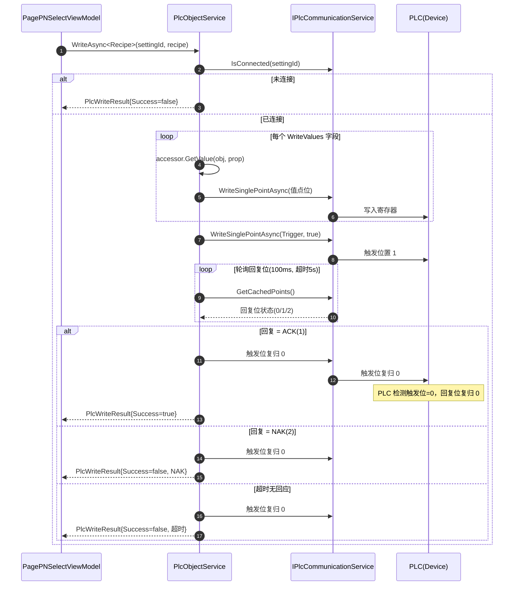
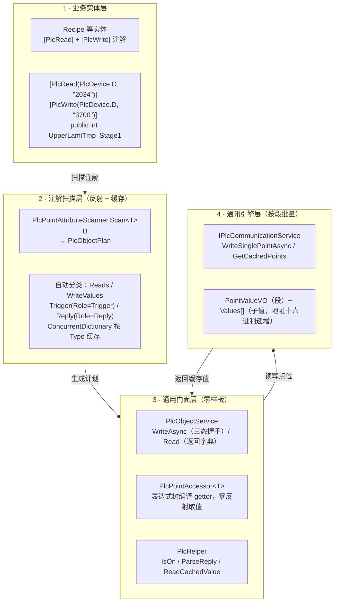

# PLC 通讯架构 - UML 图（v3.0 读写注解分离 + 通用门面）

> 与 `docs/plc-framework.md` 保持一致。以下为可编辑 Mermaid 源码，可粘贴到
> [Mermaid Live Editor](https://mermaid.live) 等站点二次编辑。

## 1. 核心类图

```mermaid
classDiagram
    direction TB

    class PlcDevice {
        <<enumeration>>
        D=0
        W=1
        M=2
        X=3
        Y=4
        L=5
        F=6
        V=7
        B=8
        S=9
        SM=10
        SD=11
    }

    class PlcWriteRole {
        <<enumeration>>
        Value=0
        Trigger=1
        Reply=2
    }

    class PlcReadAttribute {
        +PlcDevice DeviceCode
        +string Address
        +int Offset
        +string DisplayName
    }

    class PlcWriteAttribute {
        +PlcDevice DeviceCode
        +string Address
        +int Offset
        +string DisplayName
        +PlcWriteRole Role
    }

    class PlcReadDefinition {
        +string PropertyName
        +PlcDevice DeviceCode
        +string Address
        +int Offset
        +Type DataType
        +string DisplayName
    }

    class PlcWriteDefinition {
        +string PropertyName
        +PlcDevice DeviceCode
        +string Address
        +int Offset
        +Type DataType
        +string DisplayName
        +PlcWriteRole Role
    }

    class PlcObjectPlan {
        +IReadOnlyList~PlcReadDefinition~ Reads
        +IReadOnlyList~PlcWriteDefinition~ WriteValues
        +PlcWriteDefinition Trigger
        +PlcWriteDefinition Reply
    }

    class PlcPointAttributeScanner {
        -_cache ConcurrentDictionary~Type, PlcObjectPlan~
        +Scan~T~() PlcObjectPlan
        +Scan(Type) PlcObjectPlan
    }

    class PlcPointAccessor~T~ {
        -_getters IReadOnlyDictionary~string, Func~
        +PlcObjectPlan Plan
        +GetValue(obj, propertyName) object
    }

    class PlcHelper {
        +ReplyPending=0
        +ReplyAck=1
        +ReplyNak=2
        +IsOn(text) bool
        +ParseReply(text) int
        +ReadCachedValue(cached, device, address) string
    }

    class IPlcObjectService {
        <<interface>>
        +WriteAsync~T~(settingId, obj) Task~PlcWriteResult~
        +Read~T~(settingId) IReadOnlyDictionary~string,string~
        +IsConnected(settingId) bool
        +IsWriteSuccess~T~(settingId) bool
    }

    class PlcObjectService {
        -_plcService IPlcCommunicationService
        -_accessors ConcurrentDictionary~Type, object~
        +WriteAsync~T~()
        +Read~T~()
        +IsConnected()
        +IsWriteSuccess~T~()
        -WritePointAsync(settingId, def, value)
        -WaitForReplyAsync(settingId, reply)
        -GetAccessor~T~() PlcPointAccessor~T~
    }

    class PlcWriteResult {
        +bool Success
        +string Message
    }

    class IPlcCommunicationService {
        <<interface>>
        +ConnectAsync(setting) Task~bool~
        +ReadAllPointsAsync(settingId) Task~List~PointValueVO~~
        +WriteSinglePointAsync(settingId, deviceCode, plcAddress, value) Task~bool~
        +GetCachedPoints() List~PointValueVO~
        +GetConnectedSettingIds() List~long~
        +Disconnect(settingId)
        +IsConnected(settingId) bool
        +LastError string
    }

    class PlcCommunicationService {
        -_connections ConcurrentDictionary~long, McpX~
        -_cache ConcurrentDictionary~long, List~PointValueVO~~
        -WriteWordAsync(plc, prefix, address, value)
        -ReadSinglePointAsync(plc, point)
    }

    class MockPlcCommunicationService {
        -_recipeWriteValues ConcurrentDictionary
        -SimulateRecipeWriteAsync(settingId)
    }

    class PointValueVO {
        +long SettingId
        +string DeviceCode
        +string PlcAddress
        +int Quantity
        +Values[]
    }

    class PointSubValueVO {
        +string DeviceCode
        +string PlcAddress
        +string Value
    }

    class Recipe {
        +int UpperLamiTmp_Stage1
        +double DrvSpeed
        +bool WriteTrigger
        +int WriteReply
    }

    PlcReadAttribute --> PlcDevice
    PlcWriteAttribute --> PlcDevice
    PlcWriteAttribute --> PlcWriteRole
    PlcReadDefinition --> PlcDevice
    PlcWriteDefinition --> PlcDevice
    PlcWriteDefinition --> PlcWriteRole
    PlcObjectPlan *-- PlcReadDefinition
    PlcObjectPlan *-- PlcWriteDefinition
    PlcPointAttributeScanner --> PlcObjectPlan
    PlcPointAccessor --> PlcObjectPlan
    PlcObjectService ..|> IPlcObjectService
    PlcObjectService --> PlcPointAccessor
    PlcObjectService --> PlcHelper
    PlcObjectService --> PlcWriteResult
    PlcObjectService --> IPlcCommunicationService
    PlcCommunicationService ..|> IPlcCommunicationService
    MockPlcCommunicationService ..|> IPlcCommunicationService
    PlcCommunicationService --> PointValueVO
    PointValueVO *-- PointSubValueVO
    Recipe ..> PlcReadAttribute
    Recipe ..> PlcWriteAttribute
```

---

## 2. 配方下发 · 三态握手时序图

---

## 3. 注解 → 读写链路 · 分层数据流

